# LOTS CRM — whole-project workflow

This chart describes how the CRM is wired together, from the agent opening the app to case completion and the supporting admin, data, and integration flows. The interactive **LOTS Workflow** screen remains the detailed customer-care SOP chart; this document is the wider system map.

## System map

```mermaid
flowchart TB
  subgraph People[People and entry points]
    Agent[Customer-care agent]
    Admin[Team lead / administrator]
    Browser[Browser: React app]
    Phone[Customer phone call]
    Inbox[contactus@cpwi.in mailbox]
    StoreTeam[Store or HO team]
    Customer[Customer]
  end

  Agent --> Browser
  Admin --> Browser
  Phone -->|SparkTG widget, call events| Browser
  Inbox -->|Microsoft Graph mailbox polling| Auto
  Browser -->|/api requests, x-agent / session| API[Express API: server/index.js]

  subgraph Frontend[Frontend: src/]
    Browser --> Shell[App shell: navigation, agent, dialer, missed-call bar]
    Shell --> Screens[Dashboard · New Case · Inbox · Calls · Contacts · Cases · Follow-ups · Leads · Knowledge · Admin]
    Screens --> Client[Shared API fetch wrapper]
    Client --> API
    FlowScreen[LOTS Workflow chart] -->|live counts| API
  end

  subgraph Backend[Backend services: server/]
    API --> Auth[Optional sign-in / role guard]
    Auth --> Core[Core case rules, status transitions, lookup, timelines]
    API --> CallsService[Call capture and SparkTG sync]
    API --> MailService[Mailbox and email service]
    API --> Auto[Automation engine]
    API --> Support[Knowledge support / help tickets]
    Auto <--> Core
    Auto <--> MailService
    Auto --> Teams[Microsoft Teams email previews]
    Core --> WorkflowRules[Case workflows + TAT + escalation matrices]
    CallsService --> Core
  end

  subgraph Data[Persistence]
    Core --> DataStore{Configured database}
    Auto --> DataStore
    CallsService --> DataStore
    Support --> DataStore
    DataStore -->|MYSQL_HOST + MYSQL_DATABASE| MySQL[(MySQL: lots)]
    DataStore -->|otherwise| JSON[(server/data/db.json)]
    DataStore --- Entities[Cases · contacts/members · calls · missed calls · leads · settings · logs · outbox]
  end

  subgraph Integrations[External systems]
    SparkTG[SparkTG telephony API / widget]
    Microsoft[Microsoft 365 / Graph]
    Teams
    Vtiger[Vtiger import tools]
  end
  Browser <--> SparkTG
  CallsService <--> SparkTG
  MailService <--> Microsoft
  Auto -->|email send, or Teams preview while enabled| Teams
  API --> Vtiger
  Screens -->|lookup caller by phone, card, name, email| Core
  Customer --> Phone
  Core -->|case update / resolution| Customer
  Auto -->|acknowledgement, escalation and reminders| StoreTeam
  Core -->|escalation with matrix target and attachments| StoreTeam
  StoreTeam -->|reply / resolution| Core
```

## Agent and case lifecycle

```mermaid
flowchart LR
  Start([Agent opens CRM]) --> SignIn{Sign-in required?}
  SignIn -->|Yes| Login[Name and password]
  SignIn -->|No| Agent[Select or add agent name]
  Login --> Workspace[Dashboard and shared navigation]
  Agent --> Workspace
  Workspace --> Channel{Customer contact source}

  Channel -->|Inbound / outbound call| Call[SparkTG call and caller panel]
  Channel -->|Missed call| Missed[30-minute callback queue]
  Channel -->|Email| Email[Mailbox inbox]
  Channel -->|Walk-in / follow-up / other| New[Log New Case]
  Call --> Lookup[Identify caller using phone, card, membership, email or name]
  Missed --> Lookup
  Email -->|Automatic import when connected| Read[Read, link, classify email]
  Email -->|Manual handling| Read
  Read --> Case[Create or find case]
  Lookup --> New
  New --> Case
  Case --> Categorize[Choose contact type, case type, category and subcategory]
  Categorize --> Requirements[Capture store, order/invoice and required details]
  Requirements --> Decide{Can agent resolve now?}
  Decide -->|Yes| Resolve[Share answer / resolve on contact]
  Decide -->|Need customer information| Waiting[Waiting for customer]
  Decide -->|Needs store or team| Escalate[Escalate to workflow/matrix owner]
  Waiting -->|Customer provides details| Pending[Pending agent action]
  Pending --> Decide
  Escalate --> Track[Track TAT, level, promises and daily follow-up]
  Track -->|Store/team reply| Review[Review reply and share resolution]
  Review --> Confirm[Customer confirmation call / follow-up]
  Resolve --> Confirm
  Confirm -->|Satisfied| Closed([Closed])
  Confirm -->|Not satisfied| Escalate
  Closed -->|Reopened| Pending
  Case -.-> Timeline[Timeline, files, linked calls and emails]
  Timeline -.-> Case
```



## Supporting workflows

| Area | How it works |
| --- | --- |
| Calls | The SparkTG widget handles calls in the browser. Call events and call-detail sync populate call history; caller lookup links a call to a member and case. Missed calls appear in the top bar and are worked from the callback queue. |
| Email | When Microsoft sign-in is connected, the automation engine imports mailbox messages as Pending cases, attempts categorisation/linking, and can acknowledge or route them. Agent replies are threaded and logged on the case. While Teams preview mode is enabled, outgoing email previews go to Teams instead of the recipient. |
| Escalations | Case type/category selects a workflow owner and required fields. Store rows or HO team rules determine the destination and TAT. Follow-ups track due dates, levels, promises, and replies; resolution is shared with the customer and confirmation closes the case. |
| Outbound leads | Admin/agents load call lists for registration, inactive customers, order-on-call, LCC, confirmation, follow-up, surveys, or offers. Outcomes can change linked case state and save survey feedback. |
| Contacts | Member/contact data supports caller lookup, case linking, call context, imports, and contact history. |
| Admin | Configure agent accounts, stores and team contacts, workflows, escalation matrices, holidays, picklists/dependencies, automation switches, mailbox, and integration settings. |
| Dashboard and reports | API summaries and the `/api/flow` endpoint supply live operational counts for the dashboard and interactive LOTS SOP chart. |
| Support | Knowledge articles answer staff questions; unresolved questions can be tracked as support tickets for the help desk. |

## Runtime and data path

1. `src/main.jsx` starts the React app; `src/App.jsx` provides navigation, agent/auth state, shared metadata and refreshed dashboard statistics.
2. Screens call `src/api.js`, which sends JSON requests to `/api` and includes the current agent identity. The optional auth guard is applied by the Express server.
3. `server/index.js` routes requests to core case rules and the supporting services: calls, mail, automation, support, imports, and reporting.
4. `server/db.js` loads one shared data model. It uses MySQL when the MySQL host and database are configured; otherwise it uses the JSON data file. Case rules and screens use the same model either way.
5. Integrations are configured outside the UI: private credentials are read from the user's `.lots-crm/secrets.env`; `.env` contains non-secret settings. The browser does not receive those credentials.
6. On startup, the server starts the automation scheduler, call-detail sweep, and contact index. The service health endpoint reports runtime/database health for the Windows background service.

## Main code locations

- Frontend shell and API client: `src/App.jsx`, `src/api.js`
- Case state and shared business rules: `server/core.js`
- HTTP API and startup: `server/index.js`
- Case-specific routing, requirements and TAT: `src/workflows.js`, `src/requirements.js`, `src/escalationMatrix.js`, `src/storeMatrix.js`
- Automation and email flows: `server/automation.js`, `server/mail.js`, `server/aiReader.js`
- Calls and telephony: `server/calls.js`, `server/sparktg.js`, `src/sparktg.jsx`
- Data adapter and schema: `server/db.js`, `server/mysql-store.js`, `server/schema.sql`
- Detailed customer-care SOP chart: `src/pages/LotsFlow.jsx` (interactive) and `lots-workflow.svg` (static)

## Existing design boundaries

- SMS and OMS are not currently connected; they require provider/system access.
- Mail-based automation requires the mailbox connection. Some SparkTG functions require its account configuration.
- Access control is optional and is enabled/configured through the admin user settings.
- The detailed SOP chart shows the operational case journey; this map documents the broader software and data flow.
