# LOTS CRM: complete process documentation

28 October 2026 · source of the PDF in Downloads and of the shared doc "LOTS CRM: complete process documentation". The flow charts are in docs/flows/.

Every process in the LOTS customer-care CRM as it works today, from the first call to the closed case. Email handling is left out: the contactus@cpwi.in mailbox is not connected yet.

## Overview

The CRM holds about **3.23 lakh contacts** and **1.92 lakh cases** brought over from Vtiger, plus every case logged here. Calls run through the SparkTG dialer built into the CRM. Case types and categories follow LOTS's case master; escalations follow LOTS's escalation matrix.

| Menu item | What it is for |
| --- | --- |
| Dashboard | What needs attention now, open cases by status, 14-day trend |
| Log new case | Create a case (the caller is usually filled in already) |
| Call logs | Every call with outcome, talk time, recording and linked case |
| Contacts | Find, create and edit customers; their communication history |
| Cases | Search and filter all cases; export |
| Report | Counts and case lists for a date range; export |
| Support | Help articles and support tokens |
| Admin | Set-up for the team lead (section 14) |

Other lists: **Missed calls** (the two boxes at the top of every page), **Follow-ups** (Dashboard tiles) and **Outbound leads** (address /leads).

## 1. Sign in

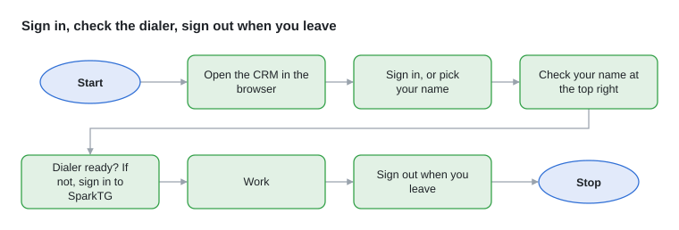

1. Open the CRM in the browser.
2. Sign-in on: choose your name, type your password, select **Sign in**. Sign-in off: pick your name when asked.
3. Check your name at the top right; everything you do is saved with it and the time.
4. Check the dialer at the top: **Dialer ready** means calls work; **Dialer: sign in** means log in to SparkTG in the dialer first.
5. Leaving a shared computer: **Sign out** (or **Switch agent** when sign-in is off).

## 2. Contacts

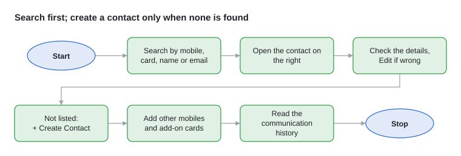

**Find or create a contact**

1. Open **Contacts** and search by mobile, membership / card no., name, business name, email or GSTIN.
2. Tap the contact. Its details open on the right with **Call**, **WhatsApp**, **Log case** and **Edit**.
3. Check the details with the customer; correct them with **Edit**.
4. Not listed: **+ Create Contact**, fill in what you have (the form has the same fields as Vtiger) and save.
5. Add alternate mobiles and up to 4 add-on card holders where relevant.

**Number rules the CRM checks**

- A **membership card no.** belongs to one contact only.
- A **mobile** belongs to one contact, unless each contact sharing it has its own card no.
- A shared mobile that calls or is searched lists all its contacts: ask which customer is calling and pick them.

**Communication history:** under the contact's details, newest first: calls with talk time and recording, missed calls, and cases (including those imported from Vtiger). Cases logged before the contact existed are attached automatically when the contact is created or edited, if the mobile, email or card no. matches.

## 3. Calls

On every incoming and outgoing call a **caller panel** opens: the number, the contact, their open cases, **+ New Case**, **All cases** and **Link this call to this case**.

**Incoming call**

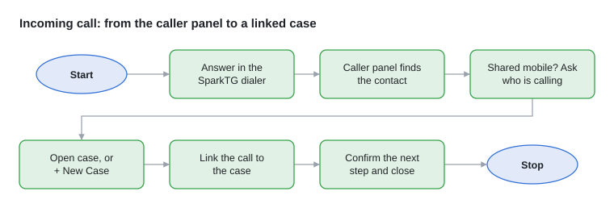

1. Answer in the SparkTG dialer and greet the customer as per the SOP.
2. Read the caller panel:
    - one contact: confirm it is the right person or business;
    - "N contacts share this mobile": ask who is calling and pick them;
    - "Not a registered member": note their details; create a contact if appropriate.
3. About an open case: open it and **Link this call to this case**. A new concern: **+ New Case** (section 4).
4. Before ending, repeat the concern, the next step and any promised follow-up. Close with "Is there anything else I can assist you with?"

**Missed call: call back within 30 minutes**

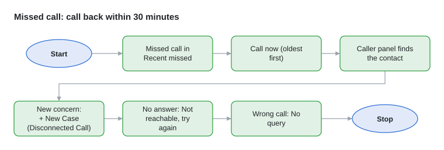

1. Missed calls arrive by themselves in **Recent missed** at the top of every page; one tried once without reply moves to **2nd round**. A box turns red when a call is past 30 minutes.
2. Open the box, select **Call now** on the oldest call. The caller panel identifies the number.
3. New concern: **+ New Case** (Type of call **Disconnected Call**, the missed call linked). Open case: link the call to it.
4. No answer: **Not reachable** (it moves to 2nd round; try again). Wrong or test call: **No query**.
5. The full list is behind the link in either box. A missed call that did not come in by itself: **Add missed call**.

**Outgoing call**

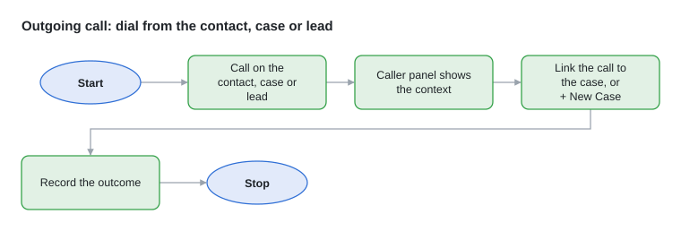

1. Start it with **Call** on the contact, case or lead; the dialer dials.
2. The caller panel shows what you called from. Link the call to the case, or **+ New Case** for a new concern.
3. Record the outcome (for a lead, also the lead's result).

**Call logs:** every call taken or made in the CRM dialer, with date, direction, agent, outcome, talk time, linked case and **recording** (play or **Download**). Filter by Today / 7 days / 30 days / All or dates, agent, direction, outcome, "with recording"; search by number, name, agent or case no.

**A call never creates a case by itself.** Create a case for a new concern, or link the call to the case it belongs to.

## 4. How cases are created

Every case gets a number (**LWS-000123**), its creator, the time, and the agent it is **assigned** to (the agent who logs it).

| Route | How the case starts | Channel / Type of call |
| --- | --- | --- |
| Incoming call | **+ New Case** in the caller panel; the caller and the call are filled in | Call · Inbound |
| Missed-call callback | **+ New Case** after calling back from the missed-call boxes; the missed call is linked | Call · Disconnected Call |
| Outgoing call | **+ New Case** in the caller panel during the call | Call · Outbound |
| Calling list (lead) | The customer raises a concern: **+ New Case** from the caller panel | Call · Outbound |
| Walk-in, store message, other | **Log new case** in the menu, caller searched by hand | Call (choose the type) |
| From the contact | **Log case** on the contact's page | as chosen |
| Imported from Vtiger | Brought over by the Vtiger import (section 10), as history | as in Vtiger |

**Log new case: the steps**

1. **Identify caller** (top): one search box for mobile, card no., membership ID, name, business name or email. A match fills in the contact; several matches are listed to pick from; no match: type the details yourself.
2. **① How did they contact us?** Channel **Call**, Type of call **Inbound**, **Outbound** or **Disconnected Call**. **Called number** (or tick "Same as contact's mobile"); the **Call transaction ID** fills in itself on a live call.
3. **② Who is it?** Type of contact (Registered With Lots, Not Registered, Others), name, business name, mobile, card no., email.
4. **③ What is the concern?** **Case type** (Inquiry, Issues or Complaint, Request), then **Category** and **Sub-category** from the case master. Then store, invoice / order no., date of purchase, purchase and refund amount where they apply, and **Details**: what the customer said.
5. Read the **documents needed** and the **SOP answers** shown beside the form for that category.
6. **④ What happens now?** **Resolved over telephone (ROT)** with the resolution given (the case closes) · **Info missing → Waiting** · **Escalate** to the store / team (section 7).
7. Ask "Is there anything else I can assist you with?", then **Save case**.

## 5. Case statuses

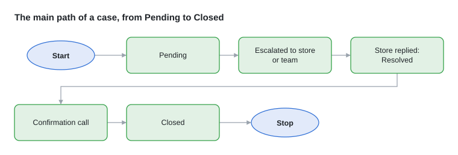

A case moves only along the LOTS workflow chart. **What to do now** on the case page shows the next action and offers only the moves allowed.

| Status | Meaning | Buttons |
| --- | --- | --- |
| **Pending** | Needs agent action | Resolved on call (ROT) → Closed · Info missing → Waiting · Escalate to store |
| **Waiting** | Details needed from the customer | Customer provided details → Pending |
| **Escalated** | A store or team must act; its TAT runs | Store replied → Resolution |
| **Resolved** | The store / team gave the resolution | Confirmation call: customer confirmed → Close · Not satisfied → Re-escalate |
| **Closed** | Done | Reopen (back to Pending) |

A case answered on the call goes straight from Pending to Closed. **Resolved** is only for escalated cases.

## 6. Work cases every day

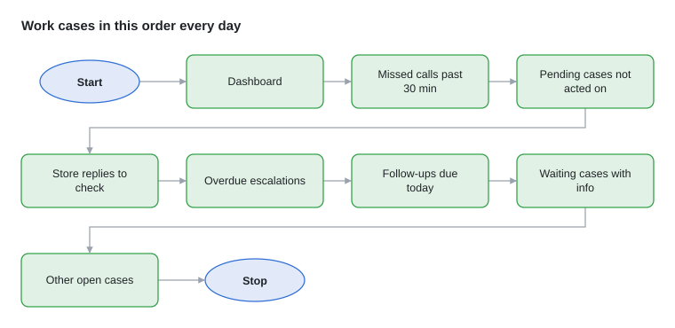

**Start on the Dashboard.** Its tiles: **Escalations overdue**, **Store follow-ups due today**, **Store replies to check**, then open cases by status, the 14-day trend, escalations by store and the top open categories. Each tile opens its list.

**Find your work:** **Cases** → choose your name in **Any agent** (your cases), or filter by status, channel, type or store. Unassigned cases: take them, or the team lead assigns them.

**Order of work**

1. Missed calls past 30 minutes, and customers waiting for an answer.
2. Pending cases no agent has acted on yet.
3. Store / team replies to check.
4. Escalations past their TAT, and promised dates that have passed.
5. Store follow-ups due today.
6. Waiting cases where the customer has now sent the missing details.
7. Other open cases, by deadline and impact.

**Record everything on the case**

1. Open the case and choose the entry type: **Internal note**, **Call with customer** or **Store / team follow-up call**.
2. Write what happened, or pick a ready SOP note. It is saved with your name and the time.
3. **Edit details** to correct the contact, category, store, invoice no., amounts or the assigned agent.
4. **Files**: add bills or photos; they go with the escalation.
5. **Call customer** dials and links the call to the case.

**Imported Vtiger cases:** the 539 still open in Vtiger came in as Pending or Resolved with no agent. The team lead shares them out; work them like any other case.

## 7. How escalation works

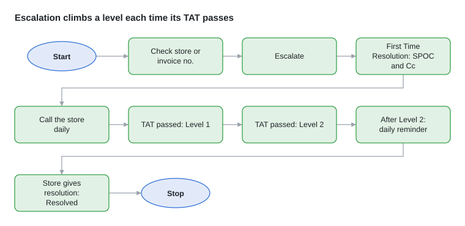

An escalated case goes to the store or team responsible for its category, and climbs **First Time Resolution → Level 1 → Level 2** each time its TAT passes without a resolution.

**Who the case goes to**

The case type and category decide the owner (from LOTS's case workflows):

| Owner | Which cases | Contact used |
| --- | --- | --- |
| Store | Store-related complaints and requests | The store on the case, from the **store escalation matrix** (per store: store, App, E-commerce and BDA rows) |
| Home store (membership desk) | Membership and card cases | The customer's registered store |
| HO team | E-commerce / App, IT / Website, BDA, HR / Careers, Administration, Marketing, Category / Supplier | That team's row in the **HO escalation matrix** |
| Care desk | Answered on the call (ROT) | Not escalated; if it must be, it goes to the store |

Each matrix row gives, for every level, the SPOC (To), the people in Cc and the TAT.

**Before escalating**

1. The CRM checks what the workflow needs: usually the **store** (not "Not set") or the **order / invoice no.** If something is missing it says so and does not escalate.
2. Add the details and files (bills, photos) first; they go with the escalation.

**When you select Escalate**

1. The case becomes **Escalated** at **First Time Resolution**, and its deadline is set from that level's TAT.
2. The CRM writes the escalation to the SPOC (To) and Cc in LOTS's format ("Hi Team, Greeting for the day!" and the details of the query) with the files. **Until the mailbox is connected, this message is posted in the Teams channel instead of being emailed**, so also call the store / team SPOC.
3. The timeline records who it went to and when.

**The levels**

| Level | When | Goes to |
| --- | --- | --- |
| First Time Resolution | When the agent escalates | The row's first SPOC + Cc |
| Level 1 | First Time Resolution TAT passed without resolution | Level 1 SPOC + Cc, marked "ESCALATION Level 1" and "Reminder#n" |
| Level 2 | Level 1 TAT passed | Level 2 SPOC + Cc |
| After Level 2 | Level 2 TAT passed | A reminder every working day until it is resolved; there is no Level 3 |

**TAT counting:** working hours 9 AM–9 PM, Monday to Saturday. Sundays and the holidays in Admin do not count. Some case types run longer as per the SOP (for example refunds and new suppliers: 7 working days).

**Following up**

1. Call every store / team with an open escalation **once a day** (Follow-ups page, from the Dashboard tiles). It shows per store: open, overdue, above Level 1, promises missed, not followed up today, last call.
2. Record each call on the case as **Store / team follow-up call**, with any promised date.
3. The CRM also sends each store its list of open escalations every day at 10:00 (in Teams for now).

**The reply**

1. The store / team gives the resolution (today by phone or message): select **Store replied → Resolution** and write it. The case becomes **Resolved**.
2. Only an update: leave it Escalated and follow up again tomorrow.
3. Wrong store or team: correct the store or category under **Edit details** and note why.

Admin → **Escalation flow** shows the HO matrix as a chart per case type.

**Every route, with its TATs:** section 16 lists all 58 store routes (the same for each of the 6 stores), the 12 HO routes and the other escalation paths.

## 8. Finish the case

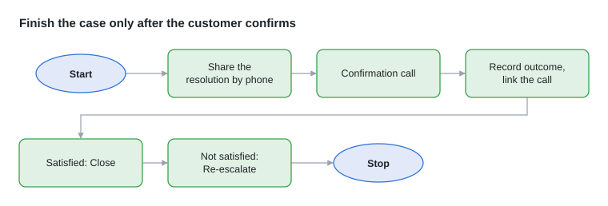

1. Share the resolution with the customer by phone.
2. A case that became **Resolved** gets a **confirmation call** in Outbound leads by itself; make it.
3. Record the outcome and link the call to the case.
4. Customer satisfied: **Confirmation call: customer confirmed → Close**.
5. Not satisfied: **Not satisfied → Re-escalate**. The case goes back to the store / team.
6. A closed case that needs more work: **Reopen** (back to Pending).
7. Check the timeline holds every call, follow-up, promised date and the resolution.

## 9. Outbound calling lists

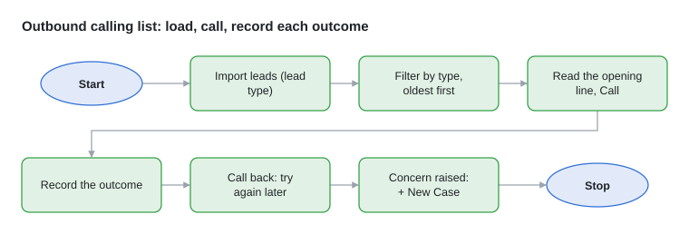

SOP target: **80–100 outbound calls a day** per agent. Open **Outbound leads** at the CRM address followed by **/leads** (no menu link at the moment).

**Lead types:** New registration · Inactive customer · Order on call · LCC (Lots Club Card) · Confirmation / resolution · Follow-up · Customer survey · Festival & seasonal offers. Confirmation and Follow-up calls are added by the CRM; the others come from calling lists.

**Load a list:** **Import leads** → choose the lead type → paste one per line: name, phone, business name, store code (copy from Excel works) → save.

**Work the list**

1. Filter by type; start with the oldest due call.
2. Read the opening line at the top (SOP script), then **Call**.
3. Record the outcome (table below).
4. Call back / Not reachable keeps the lead for another try.
5. A complaint during the call: **+ New Case** from the caller panel.

| Call | Outcomes | What the CRM does |
| --- | --- | --- |
| Confirmation / resolution | Confirmed resolved · Not satisfied · Call back · Not reachable | Confirmed → case Closed · Not satisfied → back to the store |
| Follow-up (Waiting case) | Info received · Update given · Call back · Not reachable | Info received → case back to Pending |
| Customer survey | Survey completed · Refused survey · Call back · Not reachable | Survey completed → note the customer's feedback |
| Other lists | Interested · Not interested · Call back · Not reachable · Order placed · Converted | Saved on the lead |

## 10. Import contacts and cases

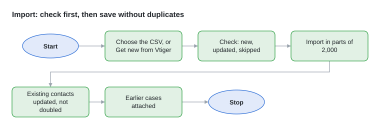

For the team lead or admin. The CRM never adds a contact twice: one already there (same Vtiger contact, same membership card no., or same mobile when there is no card no.) is updated instead.

**Contacts from a CSV file**

1. **Contacts** → **Import CSV** → choose the file. A Vtiger export, or any sheet with the contact form's column names, fills in every field.
2. Read the check shown before anything is saved: **N new · N already in the CRM (updated) · N skipped · N without a mobile or card no.**, and why each row is skipped.
3. **Import: N new, N updated**. Large files go in parts of 2,000 with a progress bar.
4. Earlier cases with the contact's mobile, email or card no. are attached to it.

**Straight from Vtiger**

1. **Import from Vtiger** (Contacts) and **Import cases from Vtiger** (Cases) show the last import.
2. **Get new contacts from Vtiger** / **Get new cases from Vtiger** read only what was added in Vtiger since.
3. It runs on the CRM server; the page can be closed. **Stop** keeps what was read; **Continue** goes on.
4. Vtiger cases come in as history: only those still open in Vtiger are open here (Pending or Resolved), none start an escalation, and each is attached to its contact when the contact is in the CRM.

**Rules every import keeps**

- A card no. belongs to one contact; a mobile may be shared only by contacts that each have their own card no.
- The same contact twice in one file becomes one; the first row is kept.
- Rows with no real mobile and no card no. (e.g. ?????) are left out.

**Brought over so far:** 3,35,067 Vtiger contacts read and 3.23 lakh in the CRM (duplicates without their own card no. and contacts without a number left out); all 1,92,396 Vtiger cases, 1,38,796 attached to a contact.

## 11. Reports and Dashboard

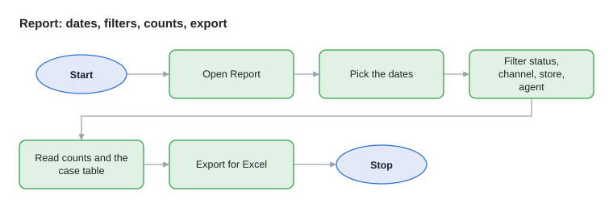

1. Open **Report** in the left menu.
2. Pick the dates on the calendar or a quick range.
3. Filter by status, channel, store or agent.
4. Read the counts, then the cases table below the calendar.
5. **Export** the same cases for Excel.

The **Dashboard** shows the last 14 days of cases and the mix by channel. **Cases** → **Export CSV** exports any filtered case list.

## 12. Help: Support

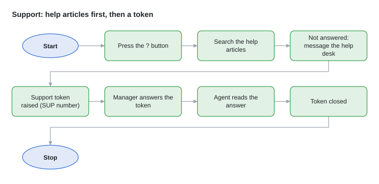

**Agent with a question about the CRM**

1. Select the **?** button at the bottom right of any page.
2. Type the question; matching help articles appear (**All help topics** lists them all).
3. Not answered: write **Your message to the help desk manager** and send. A support token (SUP-000123) is raised with the page and case you were on.
4. The answer appears in the same window; reply there if needed.

**Help desk manager**

1. **Support** in the left menu → **Support tokens**: every token with agent, page, case and status.
2. Open a token, read the **Conversation**, write under **Answer the agent**, send.
3. Close the token when settled. New tokens are posted in Teams.

## 13. What the CRM does automatically

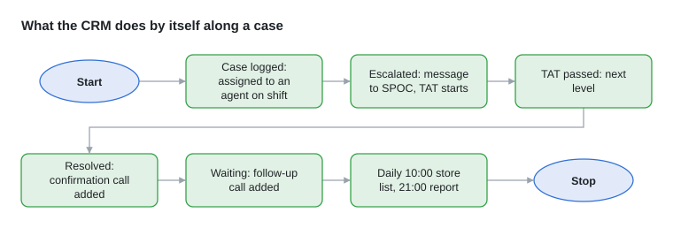

These run by themselves (Admin → **Automation** switches each on or off). Messages to stores and teams are posted in the **Teams channel** until the mailbox is connected.

| When | The CRM |
| --- | --- |
| A case is logged without an agent | Assigns it to an agent on shift |
| A case is escalated | Writes the escalation to the matrix SPOC and Cc and starts the TAT |
| An escalation TAT passes | Moves the case to the next level (Level 1, Level 2) with a reminder |
| A case is past Level 2 | Sends a reminder every working day |
| A case becomes Resolved | Adds a confirmation call to Outbound leads |
| A case is Waiting | Adds a follow-up call to ask for the missing details; reminds after 48 hours |
| A case is Closed | Adds a survey call, when that switch is on (off now) |
| Every day at 10:00 | Sends each store its list of open escalations |
| Every day at 21:00 | Sends the daily report |
| A missed call reaches no agent | SparkTG's call event adds it to the missed calls by itself |

## 14. Admin set-up

For the team lead. All of these are under **Admin**.

**Users and sign-in**

1. **Users and sign-in**: set each person's **Password** and role (**Agent** or **Admin**). Admins see the set-up pages and start imports.
2. Give at least one Admin a password, then switch on **Require sign-in**.
3. Forgotten password: set a new one here. Someone leaves: remove their password.

**Stores, teams and holidays** (**Stores & settings**)

1. **Store SPOCs**: each store's SPOC name and phone for follow-up calls.
2. **Teams (escalations other than stores)**: each HO team's contact.
3. **Holidays**: add each holiday; holidays and Sundays do not count in TATs.
4. **Agents**: each agent and their SparkTG email (the dialer signs them in with it).

**Escalation matrix**

1. The store matrix comes from LOTS's workbook "Escalation Matrix LOTS". When LOTS changes it, open the matrix import, select **Refresh now**, check the changes and apply.
2. **Escalation flow** shows the HO matrix per case type, to check it.

**Automation:** the switches in section 13, the timers (Waiting reminder 48 hours, store list 10:00, daily report 21:00), who gets Level 2 messages and the daily report, and each agent's **shift** (9–18, 10–19, 11–20, 12–21) for auto-assignment. Its activity log shows every automatic action.

**Case master:** **Picklists** (values of every dropdown), **Dependencies** (which values go together, e.g. categories of a case type), **Case workflows** (owner team, TAT and steps per case type) and the **LOTS workflow chart**. Change them only when LOTS changes its case master; then log a test case to check.

**SparkTG:** **Stores & settings** → **SparkTG telephony** shows the connection and the last call events. In SparkTG, set the call-event webhook and screen-pop URL shown there. Test each agent: an incoming call opens the caller panel, **Call** dials out, the call reaches Call logs with its recording.

## 15. Daily rhythm, and what is not live yet

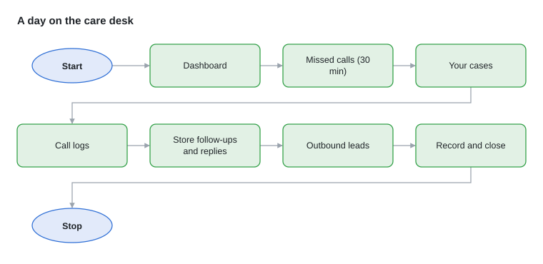

**Daily rhythm**

1. Dashboard: see what needs attention.
2. Missed calls (30 minutes) and urgent new cases.
3. Your cases (Cases → your name).
4. Call logs: calls not yet on a case.
5. Store follow-ups due today; store replies to check.
6. Outbound leads: confirmations, follow-ups, calling lists.
7. Record every action; close cases once the customer confirms.

**Call path in brief:** call → caller panel finds the contact (pick one if the mobile is shared) → open the existing case or **+ New Case** → link the call → resolve, wait or escalate → follow up daily → confirmation call → Closed.

**Not live yet**

- **Email** (contactus@cpwi.in): not connected, so this document leaves it out. Messages to stores, teams and the help desk go to the Teams channel for now.
- **Dialer with agents**: until each agent uses the CRM dialer, their calls and recordings do not reach Call logs or contact histories.
- **Older call history**: calls from before the CRM need SparkTG's call report.

## 16. Appendix: every escalation route

Generated from the escalation matrices in the CRM on 28 October 2026. Each route shows the CRM category › sub-category it applies to, who receives it and the TAT at **First Time Resolution / Level 1 / Level 2** (working hours, Mon–Sat). Named SPOCs and their email addresses are kept in the CRM (Admin → Stores & settings and Escalation flow), not in this document.

**Stores in the store matrix:** 101 NSP · 102 ITH · 103 AKD · 104 SRV · 105 DH · 106 GNI. Every store has the same 58 routes and the same TATs; the SPOCs differ per store.

### Store matrix: App (17 routes) · goes to the store's App SPOC

| Matrix row (LOTS sheet) | CRM category › sub-category | TAT: FTR / L1 / L2 |
| --- | --- | --- |
| Lots-App Technical issues (App not opening) | App Related › Technical issues and Pricing Issue | 1 day / 2 days / 3 days |
| Lots-App Content issues (page/images not clear) | App Related › Content issues | 1 day / 2 days / 3 days |
| Lots-App Account/ Profile Related (wrong details, Login Issues, OTP Issues, Unable to update address) | App Related › Account/ Profile Related | 1 day / 2 days / 3 days |
| Lots-App Account/ Profile Related- REQUESTS (Login support, address updation request etc) | App Related Request › Account/profile related Request | 1 day / 2 days / 3 days |
| Lots-App Payment & Refund Related (Payment Related complaint, Refund Related) | App Related › Payment & Refund Related | 1 day / 2 days / 3 days |
| Lots-App Pricing Related (Price higher than market/store / Pricing mismatched) | App Related › Pricing Related; App Related › Technical issues and Pricing Issue › Pricing mismatched | 1 day / 2 days / 3 days |
| Lots-App Pricing Related - REQUESTS (Price higher than market/store) | App Related Request › Pricing related - Request | 1 day / 2 days / 3 days |
| Lots-App Product related (Stock non availability, order or items in order cancelled without informing) | App Related › Product related | 1 day / 2 days / 3 days |
| Lots-App Offers and scheme (Online Offers and scheme) | App Related › Offers and scheme | 1 day / 2 days / 3 days |
| Lots-App Order Related (order not complete, Wrong products received) | App Related › Order Related › order not complete; App Related › Order Related › Wrong products received | 1 day / 2 days / 3 days |
| Lots-App Order - Delivery Related (Order Status - Not Dispatched) (App Delivery Related (Order not received) Order Status is not Dispatched) | App Related › Order-Delivery Related (order status not dispatched); App Related › Order Related › Delivery Related | 1 day / 2 days / 3 days |
| Lots-App Order - Delivery Related (Order Status - Dispatched) (App Delivery Related (Order not received) Order Status Dispatched) | App Related › Order-Delivery Related (order status dispatched) | 1 day / 2 days / 3 days |
| Lots-App Order Related (App Order Cancellations Related) | App Related › Order Related › Order Cancellations Related | 1 day / 2 days / 3 days |
| Lots-App Invoice Related, Lots-App Cancellation & Refund related request (Invoice related, incorrect invoice) | App Related › Invoice Related; App Related Request › Cancellation & Refund related request | 1 day / 2 days / 3 days |
| Lots-App Order Related, Lots-App Order status Enquiry Request (Only after query cannot be resolved through FAQs) (Others) | App Related › Order Related; App Related › Others; App Related Request › Order status inquiry Request; App Related Request › Others; App Related (any other sub-category); App Related Request (any other sub-category) | 1 day / 2 days / 3 days |
| Lots App-Product Quality (Product Quality) | App Related › Product Quality Related | 1 day / 2 days / 2 days |
| Lots App-Product Damage (Product Damage) | Product Damage (no sub-category) | 1 day / 2 days / 3 days |

### Store matrix: E-commerce (website) (16 routes) · goes to the store's E-commerce SPOC

| Matrix row (LOTS sheet) | CRM category › sub-category | TAT: FTR / L1 / L2 |
| --- | --- | --- |
| Website Technical issues and Pricing Issue (site not opening, Pricing mismatched) | E-Comm Related › Website Technical issues and Pricing Issue | 1 day / 2 days / 3 days |
| Website Content issues (page/images not clear) | E-Comm Related › Website Content issues | 1 day / 2 days / 3 days |
| Website Account/ Profile Related (wrong details, Login Issues, OTP Issues, Unable to update address) | E-Comm Related › Website Account/ Profile Related | 1 day / 2 days / 3 days |
| Website Account/ Profile Related- REQUESTS (Login support, address updation request etc) | E Commerce Related Request › Website Account/profile related Request | 1 day / 2 days / 3 days |
| Website Payment & Refund Related (Payment Related complaint, Refund Related) | E-Comm Related › Website Payment & Refund Related | 1 day / 2 days / 3 days |
| Website Pricing Related (Price higher than market/store) | E-Comm Related › Website Pricing Related | 1 day / 2 days / 3 days |
| Website Pricing Related - REQUESTS (Price higher than market/store) | E Commerce Related Request › Website Pricing related - Request | 1 day / 2 days / 3 days |
| Website Product related (Stock non availability, order or items in order cancelled without informing) | E-Comm Related › Website Product related | 1 day / 2 days / 3 days |
| Website Offers and scheme (Online Offers and scheme) | E-Comm Related › Website Offers and scheme | 1 day / 2 days / 3 days |
| Website Order Related (order not complete, Wrong products received) | E-Comm Related › Website Order Related › order not complete; E-Comm Related › Website Order Related › Wrong products received | 1 day / 2 days / 3 days |
| Website Order - Delivery Related (Order Status - Not Dispatched) (Website Delivery Related (Order not received) Order Status is not Dispatched) | E-Comm Related › Website Order-Delivery Related (order status not dispatched); E-Comm Related › Website Order Related › Website Delivery Related | 1 day / 2 days / 3 days |
| Website Order - Delivery Related (Order Status - Dispatched) (Website Delivery Related (Order not received) Order Status Dispatched) | E-Comm Related › Website Order-Delivery Related (order status dispatched) | 1 day / 2 days / 3 days |
| Website Order Related (Website Order Cancellations Related) | E-Comm Related › Website Order Related › Website Order Cancellations Related | 1 day / 2 days / 3 days |
| Website Invoice Related, Website Cancellation & Refund related request (Invoice related, incorrect invoice) | E-Comm Related › Website Invoice Related; E Commerce Related Request › Website Cancellation & Refund related request | 1 day / 2 days / 3 days |
| Website Order Related, Website Order status Enquiry Request (Only after query cannot be resolved through FAQs) (Others) | E-Comm Related › Website Order Related; E-Comm Related › Website related- Others; E Commerce Related Request › Website Order status inquiry Request; E Commerce Related Request › Website related- Others; E-Comm Related (any other sub-category); E Commerce Related Request (any other sub-category) | 1 day / 2 days / 3 days |
| Product Quality | E-Comm Related › Website Product Quality Related | 1 day / 2 days / 2 days |

### Store matrix: BDA (14 routes) · goes to the store's BDA SPOC

| Matrix row (LOTS sheet) | CRM category › sub-category | TAT: FTR / L1 / L2 |
| --- | --- | --- |
| BDA - Order Related Requests (Request to cancel order) | BDA Related REQUESTS › BDA - Order Related Requests › Request to cancel order | 1 day / 2 days / 3 days |
| BDA - Order Related Requests (Request for order status) | BDA Related REQUESTS › BDA - Order Related Requests › Request for order status; BDA Related REQUESTS › BDA - Order Related Requests | 1 day / 2 days / 3 days |
| BDA - Order Related (BDA-Incomplete Order) | BDA related › BDA - Order Related › BDA-Incomplete Order | 1 day / 2 days / 3 days |
| BDA - Order Related (BDA - Order Cancelled without communication) | BDA related › BDA - Order Related › BDA - Order Cancelled without communication; BDA related › BDA - Order Related › BDA-Order Cancelled | 1 day / 2 days / 3 days |
| BDA - Order Related (BDA-Complaint about order) | BDA related › BDA - Order Related › BDA-Complaint about order; BDA related › BDA - Order Related | 1 day / 2 days / 3 days |
| BDA - Order - Delayed Deliver Related (Order Status Not Dispatch) (BDA-Complaint about order) | BDA related › BDA Order-Delivery Related (order status not dispatched); BDA related › BDA - Order Related › BDA-delayed delivery | 1 day / 2 days / 3 days |
| BDA - Order - Delayed Deliver Related (Order Status Dispatch) (BDA-delayed delivery (Order Status- Dispatch)) | BDA related › BDA Order-Delivery Related (order status dispatched) | 1 day / 2 days / 3 days |
| BDA - Product Return Request (Request to Return products) | BDA Related REQUESTS › BDA - Product Return Request › Request to Return products; BDA Related REQUESTS › BDA - Product Return Request | 1 day / 2 days / 3 days |
| BDA - Cancellation and Invoice related (BDA-incorrect invoice) | BDA related › BDA - Cancellation and Invoice related | 1 day / 2 days / 3 days |
| BDA - Other Requests (Others) | BDA Related REQUESTS › BDA - Product Return Request › Others; BDA Related REQUESTS (any other sub-category) | 1 day / 2 days / 3 days |
| BDA - Others | BDA related › BDA-Others; BDA related (any other sub-category) | 1 day / 2 days / 3 days |
| BDA-Pricing related (BDA - Prices are higher than Market/Store) | BDA related › BDA-Pricing related | 1 day / 2 days / 3 days |
| BDA-Behaviour Related (BDA - Rude Behaviour) | BDA related › BDA-Behaviour Related | 1 day / 2 days / 3 days |
| BDA-Product Quality Related (BDA - Product Quality) | BDA related › BDA-Product Quality Related | 1 day / 2 days / 2 days |

### Store matrix: Store related (11 routes) · goes to the store SPOC

| Matrix row (LOTS sheet) | CRM category › sub-category | TAT: FTR / L1 / L2 |
| --- | --- | --- |
| Behavior of staff (Rude behaviour,No knowledge,No Support) | Store related › Behaviour of staff | 1 day / 2 days / 3 days |
| Operational issues (Cash tills/ checkout issue,Signage issue,parking issue,others) | Store related › Operational issues; Store related Request › Operational Requests | 1 day / 2 days / 3 days |
| Payment or invoice (price mismatch ,GST related,re-issue invoive, wrong product billed) | Store related › Payment or invoice; Store related Request › Payment or invoice Related Request | 1 day / 2 days / 3 days |
| Pricing issue (Price higher than market) | Store related › Pricing issue; Store related Request › Pricing Related Request | 1 day / 2 days / 3 days |
| Delivery related (order not complete,Late delivery,COD issues,rude delivery staff) | Store related › Delivery related; Store related Request › Delivery related Request | **4 hours** / 1 day / 2 days |
| Quality issue (Poor product quality) | Store related › Quality issue | 1 day / 2 days / 2 days |
| Return of goods (goods return) | Store related › Return of goods; Store related Request › Return of goods related Request | 1 day / 2 days / 3 days |
| Stock availablity (Assortment, Low stock) | Store related › Stock availablity; Store related Request › Stock availablity related Request | 1 day / 2 days / 3 days |
| Offer related (coupon/sms offer not given, cashback, freebie not given) | Store related › Offer related; Store related Request › Offer related Request | 1 day / 2 days / 3 days |
| Others | Store related › others; Store related (any other sub-category); Store related Request (any other sub-category) | 1 day / 2 days / 3 days |
| Member complaint (Member card not received, Not receiving offer communication, incorrect member details on card, others) | Membership Related › Member complaint; Membership Related (any other sub-category); Member related -NR (any other sub-category); Membership related Request (any other sub-category) | 1 day / 2 days / 3 days |

### HO matrix (12 routes) · goes to the HO team named in the row

| Matrix row (LOTS sheet) | CRM case type › category | TAT: FTR / L1 / L2 |
| --- | --- | --- |
| Projects – Real Estate | Inquiry › Real Estate | 1 day / 2 days / 3 days |
| Suppliers – Fresh | Request › New Supplier › Suppliers - Fresh | 1 day / 2 days / 3 days |
| Suppliers – FMCG – Food | Request › New Supplier › Suppliers - FMCG - Food | 1 day / 2 days / 3 days |
| Suppliers – Commodities | Request › New Supplier › Suppliers - FMCG - Commodities | 1 day / 2 days / 3 days |
| Suppliers – FMCG – Non Food | Request › New Supplier › Suppliers - FMCG - Non Food | 1 day / 2 days / 3 days |
| Suppliers – Non Food | Request › New Supplier › Suppliers - Non Food | 1 day / 2 days / 3 days |
| Suppliers – D&F | Request › New Supplier › Suppliers - D&F | 1 day / 2 days / 3 days |
| Legal | Inquiry › Legal | **4 hours** / 1 day / 2 days |
| HR (only if required) | Inquiry › HR or Jobs | 1 day / 2 days / 3 days |
| IT / Website related queries (only if required) | Inquiry › IT or Website | 1 day / 2 days / 3 days |
| Admin Related | Inquiry › Admin Related | 1 day / 2 days / 3 days |
| Marketing Related | Inquiry › Marketing related | 1 day / 2 days / 3 days |

### Other escalation paths

| Path | When | What happens |
| --- | --- | --- |
| Home store (membership desk) | Membership and card cases | The case goes to the customer's registered store, on its Member complaint row |
| Care desk case that must be escalated | A case type normally answered on the call (ROT) | It goes to the store on the case |
| Re-escalation | Confirmation call: the customer is not satisfied | **Not satisfied → Re-escalate**: the case goes back to Escalated with the same store / team |
| Escalation blocked | The workflow needs the store or the order / invoice no. and it is missing | The CRM refuses to escalate and says what to record first |
| Wrong store or team | The case was sent to the wrong place | Correct the store or category under **Edit details** and write why |
| Level corrected by an admin | The level on the case is wrong (escalated cases only) | An admin sets First Time Resolution, Level 1 or Level 2 with a reason; the timeline records it |
| Crisis or miscellaneous | Anything urgent the matrix does not cover | Use the matrix's "In any crisis situation / miscellaneous" contacts (Admin → Escalation flow) |
| After Level 2 | Level 2 TAT passed | A reminder every working day until resolved; there is no Level 3 |
